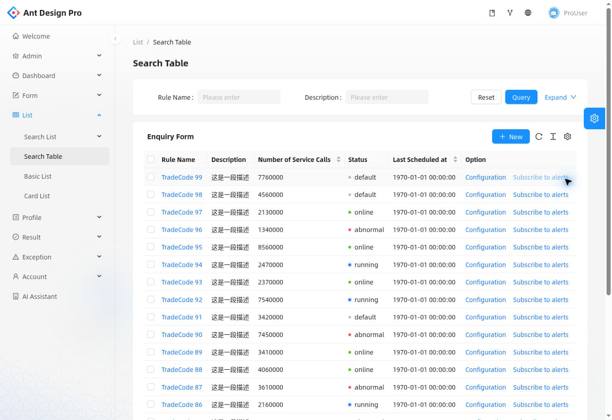
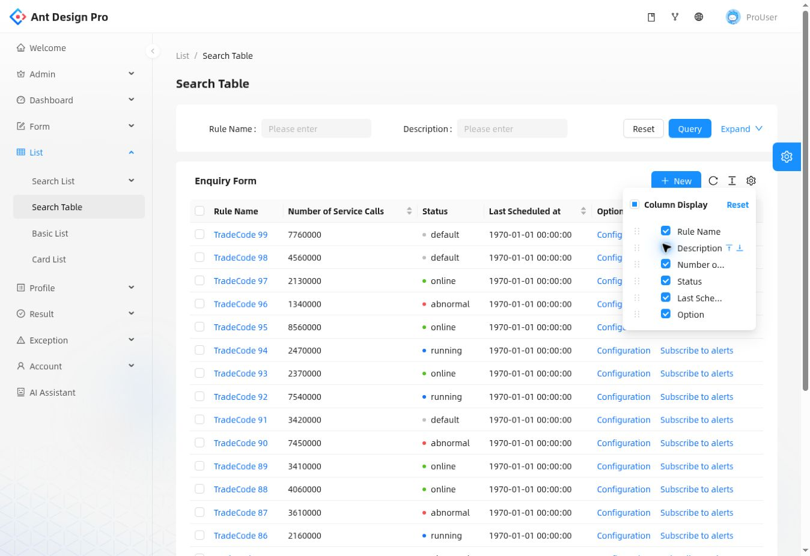
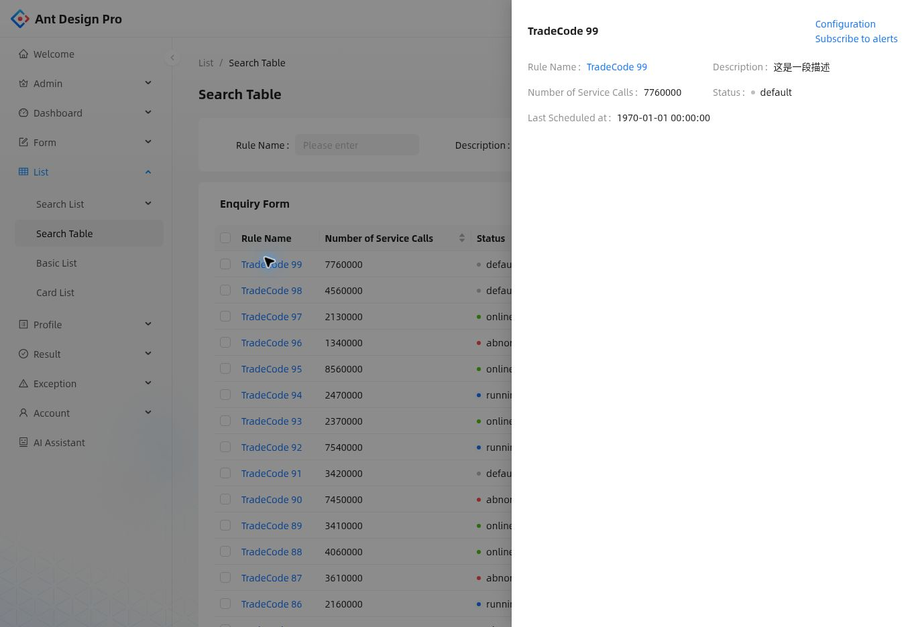

# 정형화된 완성 템플릿 하나를 선택하기

**확인일: 2026-11-06**

## 선택과 직접 볼 링크

**운영·관리 앱의 개발 중 기본 UI로 Ant Design Pro의 full 템플릿 하나를 추천한다.** 같은 앱에 이미 있는 페이지 구성을 유지하고 업무 필드·문구·API를 연결한다. 이 문서는 앞선 Atomic CRM 화면 부분 이식 추천을 대체한다.

| 대상 | 바로 보기 | 이번 판단 |
| --- | --- | --- |
| **Ant Design Pro full** | [표 목록](https://preview.pro.ant.design/list/table-list/) · [기본 입력 화면](https://preview.pro.ant.design/form/basic-form/) | **추천.** 대시보드·여러 목록·상세·폼·설정의 정해진 페이지 유형을 한 앱에서 가져올 수 있다. |
| React-admin 공식 E-commerce | [데모 로그인](https://marmelab.com/react-admin-demo/#/login) · [공식 데모 설명](https://marmelab.com/react-admin/Demos.html) | 비교 대안. 목록·상세·편집의 데이터 관리 흐름을 더 좁은 규약으로 가져오고 싶을 때 적합하다. 로그인 안내는 공개 데모 화면의 `demo / demo`다. |

두 제품을 조합하는 제안이 아니다. 기본 추천은 첫 번째 하나다. React-admin을 선택하더라도 빈 앱 생성기나 별도 headless 계층만 가져오는 대신, 공식 E-commerce 예제의 전체 프런트엔드를 기준으로 삼는다.

## 1. 실제로 본 화면

아래는 생성한 시안이 아니라 공식 공개 데모를 직접 조작해 얻은 화면이다. 예제 데이터에는 중국어 문구와 목업 날짜가 포함된다. 화면 구조와 동작을 확인하기 위한 자료다.

### 컴팩트한 표

툴바에서 밀도를 `Compact`로 바꾸면 행 높이가 줄어 한 화면에서 더 많은 행을 볼 수 있다. 검색, 표, 페이지 이동과 항목별 작업의 위치는 유지된다.

### 필요한 열만 표시

열 설정에서 `Description`을 해제했다. 표에서는 설명 열이 사라지고 선택 패널에는 해제 상태가 보인다. 열 표시/숨김 제어가 이미 제품 안에 있다.

### 상세는 별도로 열기

항목 이름을 누르면 오른쪽 상세 패널이 열린다. 표에서 숨긴 설명을 상세에서 볼 수 있고, 목록은 뒤에 유지된다. 원본 예제는 데이터가 적어 패널에 빈 영역이 크다. 이것이 모든 데이터에 최적의 폭이라는 평가를 한 것은 아니다.

캡처 출처와 라이선스는 [이미지 안내](../assets/ant-design-pro/NOTICE.md)에 기록했다.

## 2. 한 세트로 무엇을 채택하는가

현재 공식 저장소는 full 예제를 기본 제공한다. 대시보드, 표·기본·카드·검색 목록, 기본·단계·고급 폼, 기본·복합 상세, 결과·오류 화면, 계정 설정 등이 들어 있다. `simple` 명령은 이런 예제를 제거하므로 이번 목적의 출발점으로 삼지 않는다. [A1]

채택 단위는 **Ant Design Pro의 앱 틀과 필요한 페이지 구현**이다. Ant Design과 ProComponents는 원본이 사용하고 있는 내부 구성 요소다. 각기 다른 제품의 스타일과 동작을 임의로 섞는 제안과 구분한다.

| 업무 화면 | 사용할 기본 유형 | 연결할 내용 |
| --- | --- | --- |
| 여러 항목의 상태 비교 | 표 목록 | 요약 열, 검색 조건, 상태, 행 작업, 조회 API |
| 항목의 세부 정보 확인 | 상세 페이지 또는 기존 상세 패널 | 부가 정보, 관계, 이력 |
| 설정 변경 | 기본 폼 | 입력 필드, 검증, 저장 API |
| 순서가 있는 설정·등록 | 단계 폼 | 단계별 필드, 완료 조건 |
| 이미지가 중심인 항목 | 카드 목록 | 이미지, 제목, 보조 정보, 상세 연결 |

이 표는 채택 제안이다. 실제 업무를 어느 유형에 대응시킬지는 개발자가 기존 요구와 코드를 읽고 정리한다. 제품 소유자에게 여백과 버튼 배치를 반복해서 정하도록 요구하지 않는다. 별도 화면이 필요한 전문 작업도 있을 수 있지만, 일반적인 관리 기능부터 기존 페이지 유형을 사용한다.

## 3. 확인된 동작과 남는 개발 작업

**브라우저에서 확인한 것:** 공식 표 페이지 표시, 밀도 변경, 설명 열 숨김, 항목별 상세 패널, 기본 폼 페이지 표시. 화면에서 공개 데모 버전은 `6.0.1`, 배포 커밋은 `2db826cb350e46206252197f416a0a22f2b9bbfe`로 표시됐다.

**소스에서 확인한 것:** 별도로 읽은 현재 master 커밋은 `42f2cb1d303380909ea04c73b5e60679d09c321a`다. 표 페이지에 조회 요청, 행 선택, 생성·수정 연결, 삭제 후 갱신, 상세 Drawer가 있다. 공식 ProTable API에는 새로 조회하기·밀도·열 설정이 기본 툴바 옵션으로 명시돼 있다. 조회와 초기화도 별도 동작이다. 배포 데모와 현재 master는 같은 버전이라고 간주하지 않았다. [A2][A3]

**남는 개발 작업:** 실제 도메인의 API, 표시할 필드, 권한과 저장·실행 행동을 연결한다. 예제의 모든 버튼이 실서비스 기능까지 완성된 것은 아니다. 예를 들어 검사한 표 소스의 일괄 승인 버튼에는 동작 핸들러가 없다. 이런 예제 요소는 실제 기능에 연결하거나 사용자 화면에서 제외해야 한다. [A2]

열 선택 설정의 영구 저장은 별도 설정이 있다. 현재 공개 데모의 모든 설정이 다른 화면과 브라우저 재시작 후에도 유지된다고 주장하지 않는다. 자동 갱신 중의 임의 스크롤 위치와 실제 API 조건의 성능도 이번 상호작용 확인 범위를 넘어선다. [A3]

Ant Design Pro 소스는 MIT 라이선스다. 이번 기본 UI 채택을 위해 상용 UI 구독이 필수인 것은 아니다. [A4]

## 4. 왜 이전 추천을 수정했는가

초기 조사는 데이터 상태와 연결된 관리 UI를 찾는 데 집중했다. 그 과정에서 React-admin과 Atomic CRM의 실제 구현을 확인했다. 그러나 개발 중 하나의 정해진 템플릿을 사용하고 싶다는 요구에 대해, 제품 화면을 일부 가져와 별도 기반에 연결하는 설명은 선택과 조립 부담을 남겼다.

현재 선택 기준은 **기본 화면 유형이 한 제품에 이미 마련돼 있는가**다. Ant Design Pro full은 이 기준에 더 직접적이다. React-admin 공식 E-commerce도 완성된 프런트엔드 예제로서 유효한 대안이다. 해당 예제의 Orders에는 상태 탭·필터·기본 숨김 열·모바일 표시가 있고, Reviews에는 목록을 유지하는 측면 편집이 있다. [R1][R2][R3]

`create-react-admin`은 빈 앱 생성기이며, `ListGuesser`는 운영용 완성 화면 선택기가 아니다. 이 도구들을 실행하면 중요한 정보만 자동으로 골라 보여준다고 말해서는 안 된다. [R4][R5]

이번 기본안에는 Design OS, Atomic CRM 하네스, 다른 디자인 키트를 추가하지 않는다. 후일 브랜드와 시각 표현을 다듬더라도 같은 화면과 데이터 계약 위에서 변경하는 편이 유리하다는 판단이다. 모든 화면을 새로 바꾸는 디자인이라면 추가 구현이 발생한다.

## 5. 기존 디자인 문서는 의존 관계 단위로 판단한다

문서의 각 문장을 따로 채택하거나 삭제하면 안 되는 경우가 있다. 예를 들어 목록에서 정보를 줄이는 결정은 상세를 여는 경로와 함께 있어야 한다. 상세에서 돌아올 때 검색·페이지가 초기화되면 사용 흐름도 깨진다. 이것들은 하나의 작업 흐름으로 평가한다.

**함께 대응시킬 묶음:** 요약 필드, 상세 정보의 위치, 상세를 여는 동작, 목록 복귀, 필터·페이지 상태, 모바일의 같은 작업.

반면 색상, 데이터 단위, 실제 실행 권한이 모두 같은 방식으로 종속된 것은 아니다. 문서 전체를 하나의 불가분 규칙으로 취급할 필요도 없다. 기존 요구를 원본 템플릿의 화면과 코드에 연결해 다음처럼 판정한다.

| 판정 | 뜻 |
| --- | --- |
| 기존 구현이 맡음 | 원본의 동작과 코드로 충족된다. |
| 업무 연결이 필요함 | 필드·단위·API·권한·실제 행동을 우리 도메인에 맞게 연결한다. |
| 기존 선택을 대체함 | 예전 화면 구성이나 구현 방식이 새 기준과 충돌한다. 관련 묶음을 함께 전환한다. |
| 근거 부족 | 문서에 선언돼 있지만 코드나 실제 동작까지 확인되지 않았다. 완료로 표시하지 않는다. |

이 판정은 개발자가 수행한다. 제품 소유자가 디자인 규칙의 의존성을 직접 검수하는 과정을 요구하지 않는다. 구체적인 비공개 프로젝트 감사 결과는 이 공개 문서에 포함하지 않았다.

## 출처

- **A1:** [Ant Design Pro full 제공물과 사용법](https://github.com/ant-design/ant-design-pro/blob/42f2cb1d303380909ea04c73b5e60679d09c321a/README.md)
- **A2:** [실제 표 페이지 소스](https://github.com/ant-design/ant-design-pro/blob/42f2cb1d303380909ea04c73b5e60679d09c321a/src/pages/table-list/index.tsx)
- **A3:** [ProTable 공식 API](https://pro-components.antdigital.dev/en-US/components/table)
- **A4:** [Ant Design Pro MIT 라이선스](https://github.com/ant-design/ant-design-pro/blob/42f2cb1d303380909ea04c73b5e60679d09c321a/LICENSE)
- **R1:** [React-admin 공식 데모 설명](https://marmelab.com/react-admin/Demos.html)
- **R2:** [E-commerce Orders 구현](https://github.com/marmelab/react-admin/blob/67914cd9572336d0926d719d0021f7e1835f799c/examples/demo/src/orders/OrderList.tsx)
- **R3:** [E-commerce Reviews 구현](https://github.com/marmelab/react-admin/blob/67914cd9572336d0926d719d0021f7e1835f799c/examples/demo/src/reviews/ReviewList.tsx)
- **R4:** [create-react-admin의 범위](https://marmelab.com/react-admin/CreateReactAdmin.html)
- **R5:** [ListGuesser의 범위](https://marmelab.com/react-admin/ListGuesser.html)
